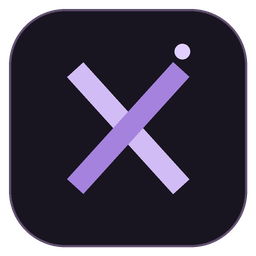

<div align="center">
  
  <h1>NEXUS</h1>
  <p><strong>A more personal desktop, one setup at a time.</strong></p>
  <p>A desktop app for making space for whatever you're doing.</p>
  <p><a href="#make-space-for-your-moments">What it does</a> · <a href="#getting-started">Getting started</a> · <a href="#documentation">Documentation</a> · <a href="CONTRIBUTING.md">Contributing</a></p>
</div>

> **Release candidate — Windows installation is not yet verified.** Windows CI has built the installer and smoke-tested the packaged app, but installation, uninstall, wallpaper switching, shortcuts, and startup still need hands-on testing. The installer is unsigned.

## Make space for your moments

Your desktop should feel right for the task at hand. NEXUS organizes your space into **categories → setups → activation**, so you can give different parts of your day their own look and useful shortcuts.

- **Start with five categories:** Gaming, Study, Work, Chill, and Custom each have a setup named Default. Create, edit, and delete categories and setups, or duplicate a setup and make it your own.
- **Set the scene:** Pick a wallpaper and accent color for each setup. On Windows, activation requests a desktop wallpaper change.
- **Keep things close:** Add websites, apps, files, and folders as shortcuts. You can choose whether each one opens automatically on activation; it is opt-in and disabled on duplicated shortcuts.
- **A little notch:** On Windows, a small always-on-top panel gives you quick access to setup switching, the active setup’s shortcuts, and media keys. Minimize NEXUS to keep the notch available; you can turn it off in Settings.
- **In-app widgets:** See the time and active setup on the overview. On Windows, send previous, play/pause and next media keys to a compatible player (track information is not displayed).
- **Suggestions, not automatic switching:** Add a daily time or Windows app-open suggestion for a setup. NEXUS asks first, and only while the app is running; accepting can open shortcuts you opted in to. App detection can miss short-lived launches.
- **Share on your terms:** Export and import portable setup files, with an optional local-only profile name. Local app paths and custom images are not included; imported links never open automatically.
- **Update when you choose:** In the packaged Windows app, use **Settings → Check for updates** to look for an official release. If one is available, NEXUS opens the release page so you can download and run the installer yourself.
- **Make it comfortable:** Choose reduced motion and, in the packaged Windows app, whether NEXUS starts when you sign in.

**Not yet implemented:** animated Windows desktop wallpapers. The overview widgets live inside NEXUS rather than on the desktop. The Windows notch, media keys and app-detection integration have automated tests, but have not yet been verified end-to-end on a Windows device.

NEXUS is a **desktop app**, not a website. The browser preview is for the interface only and cannot perform desktop actions. An experimental [Chromebook/Linux version](docs/chromebook.md) is in development; it has not been tested on a Chromebook and does not change the ChromeOS wallpaper.

## Getting started

No official GitHub releases have been published yet, so the update check currently reports that none are available. Older installations without the update button need one manual upgrade to a version that includes it. Future releases must have increasing versions and a Windows installer; see [publishing releases](docs/releases.md).

Successful [Windows workflow runs](https://github.com/mafk21/NEXUS/actions/workflows/windows.yml) provide a temporary `NEXUS-Windows-installer` artifact (GitHub sign-in and access may be required). This is not a published release and installation has not been verified.

To build the release candidate yourself on Windows, install Node.js **22.12 or newer** and Git, then open PowerShell:

```powershell
git clone https://github.com/mafk21/NEXUS.git
cd NEXUS
npm ci
npm test
npm run dist:win
```

If the build succeeds, the installer will be in `release/`. It may trigger a Windows warning because it is unsigned. The full dependency audit currently reports zero known vulnerabilities, using a temporary third-party security fork; see [dependency security](docs/security.md#dependency-audit) before building. Do not run `npm audit fix --force` without reviewing breaking changes.

For troubleshooting, development commands, and the difference between the browser preview and the desktop app, see the [development guide](docs/development.md). For a checklist before relying on an installer, see [Windows verification](docs/windows-testing.md).

## Documentation

| Guide | What's inside |
| --- | --- |
| [Development](docs/development.md) | Setup, commands, project structure, and troubleshooting |
| [Chromebook / Linux](docs/chromebook.md) | Experimental setup, requirements, and limitations |
| [Windows verification](docs/windows-testing.md) | Installer, desktop integration, and uninstall checks |
| [Privacy & storage](docs/privacy.md) | What stays on your device and when NEXUS opens external resources |
| [Security](SECURITY.md) | Private vulnerability reporting and dependency guidance |
| [Changelog](CHANGELOG.md) | Project changes and release-candidate status |
| [Contributing](CONTRIBUTING.md) | How to participate and validate changes |
| [Code of conduct](CODE_OF_CONDUCT.md) | Expectations for a respectful community |

## License

NEXUS is **source-available**, not open source. Its [personal-use license](LICENSE) allows personal, non-commercial use and private modification, but prohibits redistribution and commercial use without separate permission. See the license for the complete terms and third-party license note.
